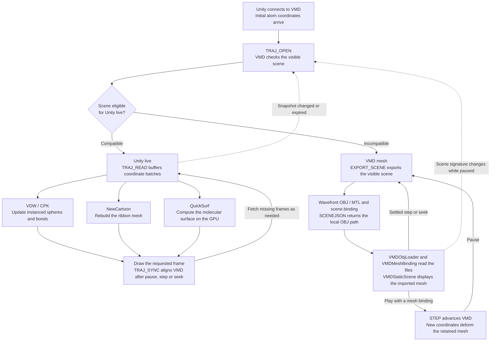

# VMD_Animation
Here is a step-by-step guide to generate scientific presentation-ready movies of biomolecular conformational changes from raw MD trajectory. Enjoy!

The repository also includes a local VMD → Unity viewer with coordinate playback, automatic representation synchronization, and VMD-generated geometry. See [VMD and Unity viewer](#vmd-and-unity-viewer) for setup and current limitations. The original movie-making workflow below remains available.
## Start
Open VMD and launch TkConsole. Ensure that your coordinate and trajectory files are located in the `VMD_Animation` directory; otherwise, specify their paths in `render.tcl`.

        cd VMD_Animation

## Render 
### Step 1. Provide the path to the PDB and XTC files with frames to be imported in `render.tcl`
Example:

```tcl
mol new mutl_open_CA.pdb
mol addfile output_NVT_timecorrected.xtc first 12800 last 16069
```

### Step 2. Modify parameters in `render.tcl` to customize the rendering.
### Step 3. Source the script
        source render.tcl

## Align all frames to a reference region
### Step 1. Source the alignment script
        source Align_all_frames.tcl
        
### Step 2. Specify the region to be aligned, molecule ID and reference frame number
Example: This command will align all frames of molecule 0 to the reference region defined by residues 331 to 508 and 863 to 1040 in frame 0.

        align_all_frames "resid 331 to 508 or resid 863 to 1040" 0 0

## Select the best viewpoint for your key conformations
### Step 1. Source the script
Take pictures while the animation is playing:

        source with_capture.tcl

Or, just play the animation without capturing pictures:

        source without_capture.tcl
        
Skip steps 2-6 if you have already saved your viewpoints to a file, then:

        source your_viewpoints_file.tcl 
        
### Step 2. Identify the key frames containing your key conformations.
### Step 3. Switch to key frame 1, save the current viewpoint as viewpoint 0:

        save_vp 0
        
### Step 4. Rotate the molecule to the desired viewpoint, then save it as viewpoint 1:

        save_vp 1
        
### Step 5. Switch to key frame 2, rotate the molecule, and save the viewpoint as viewpoint 2. Continue this process for the remaining key frames:

        save_vp 2
        
### Step 6. Write all the viewpoints to a file 

        write_vps your_viewpoint_file.tcl

## Animation
### Step 1. Set user-defined parameters. Please modify them as needed.
#### Parameter (Example)
Your animation will start at frame 70.

        set start_frame 70
        
Your animation will end at frame 3269.

        set end_frame 3269
        
Your key conformations are located at frame 83, 2957, 3104, 3268.

        set key_frames {83 2957 3104 3268} 
        
The number of frames to be captured between each key frames.

        set frames_per_section 150
        
To ensure the time interval between each key frame is the same, we do a simple calculation to skip frames: 


Animation speed: You can set the speed between 0 and 1:

        set default_speed 1.0 
        
Take 25 pictures while rotating (available in `with_capture.tcl`):

        set rotation_picture 25
        
Rotation speed: The higher the value, the slower the rotation speed (available in `without_capture.tcl`)

        set rotation_speed 300 
        
Pause time for key conformations in milliseconds

        set pause_time 35000 
        
Here, the author set the value to 35000 in `with_capture.tcl` and captured 8 frames while pausing, since the rendering method `TachyonInternal` takes some time. If using a simpler render method like `snapshot`, you can set a lower value (e.g., 3500), as shown in `without_capture.tcl`.

Time interval for capturing while the animation is paused:

        set take_picture_interval 50 #Values are under exploration
    
### Step 2. Capture
Skip step 2, if you are using `without_capture.tcl`
Create an output directory

        mkdir your_output_dir

Nevigate to your output directory

        cd your_output_dir

### Step 3. Start animation with or without capture

        init_animation

*Note: If you're using the TachyonInternal renderer with all the cool effects enabled and displaying the molecule at high resolution, the execution time is likely to be longer. However, this will depend on the performance of your computer.*

## Movie Making
The author used **VideoMatch**, a movie-making software recommended by VMD, to concatenate the output images into a complete movie.

You can download **VideoMatch** here: [VideoMatch Download](https://gromada.com/videomach/)

With **VideoMatch**, you can easily add annotations and export the final movie.

## Example: Visulize four key comformational changes of MutLα
The author used the script above to generate a movie visualizing four key conformational changes of MutLα, starting from a raw MD trajectory.

You can see the example movie here: [MutLα](https://youtu.be/FPb0yXllI84)

## VMD and Unity viewer

The repository contains an experimental local bridge between VMD and a Unity client. VMD supplies molecular data, representation settings and coordinate snapshots. Unity controls coordinate playback and its own camera; pause and seek synchronize the displayed frame back to VMD. Compatible scenes render directly in Unity, while other scenes use exported VMD meshes. The client runs on the desktop, in the XR Interaction Simulator, or in an OpenXR headset connected to the same computer; see [XR modes](#xr-modes). Headset mode has been run on a Valve Index with SteamVR only; see [VR_ISSUES.md](VR_ISSUES.md) for what was found and for the Meta Quest 3S procedure.

### Quick Start

1. Clone or download this repository. Install VMD (tested with Windows x64 VMD `1.9.4a53`) and Unity `6000.6.2f1` through Unity Hub. Run VMD and Unity on the same PC.
2. Open a fresh VMD session. In **Extensions → Tk Console**, replace the path below with the repository root and run:

   ```tcl
   cd {C:/path/to/VMD_Animation}
   source render.tcl
   source start_vr.tcl
   ```

   This loads the bundled PDB and XTC and starts the bridge. Wait for `VMD-VR bridge listening on localhost:45454`.
3. In Unity Hub, open the `Unity_VR_Client` folder as a project. After import, open `Assets/Scenes/SampleScene.unity` and enter **Play** mode. The Editor uses the XR Interaction Simulator by default, so you can do this check without a headset.
4. Wait for the molecule and the `[Unity live]` status. A PC without live QuickSurf support can show `[VMD mesh]` instead. Focus the Game view and press **Enter** to start playback. If the status stays at `[Offline]`, check that VMD is still running and the bridge is listening on port `45454`.

For a headset or a Windows build that runs without the Unity Editor, see the [build and launch procedure](VR_ISSUES.md#before-going).

### Extension folders

- `start_vr.tcl` at the repository root starts or reloads the local bridge and prepares Lines/NewCartoon visibility on the top molecule.
- `VMD_VR_Bridge/` contains the Tcl TCP bridge (`vmd_vr_bridge.tcl` and the modules it sources) and its regression test scripts (`_test_*.tcl`). The bridge is documented in this README and in the scripts' own comments; test runs may leave `_test_bridge_result_*.txt` reports there, which git ignores.
- `Unity_VR_Client/` contains the Unity 6 client project, including the scene, project settings, input configuration, and C# communication scripts.

### VMD bridge

`VMD_VR_Bridge/vmd_vr_bridge.tcl` opens a UTF-8, line-based TCP server on `127.0.0.1:45454`. It accepts local client connections, returns command results, and checks VMD state every 100 ms, broadcasting only when it changes. Because it is bound to the loopback interface and exports use shared local files, run Unity and VMD on the same computer.

**Port.** 45454 is the default on both sides. To use another port, set it in VMD before starting the bridge, and give Unity the same value:

```tcl
set env(VMD_VR_PORT) 45455
source start_vr.tcl
```

Unity's `VMDClient` uses, in order: the `-vmdPort <port>` command-line argument of a built player, the `VMD_VR_PORT` environment variable, then the **Port** field in the Inspector. `::vrbridge::start <port>` still accepts an explicit port.

**Protocol handshake.** After connecting, Unity sends `HELLO <version>`. The bridge replies `HELLO OK <version>` when it matches its `protocol_version`, otherwise `HELLO MISMATCH <bridgeVersion>`. Unity sends no other commands until the handshake succeeds. With no reply within 5 s it disconnects, shows the reason in the status bar and keeps retrying; on a mismatch, or on a bridge too old to know `HELLO`, it stops retrying until Play mode is restarted, since every retry would fail the same way. The bridge itself does not require `HELLO`, so console tests and older tools keep working. Increase `protocol_version` in the bridge and `VMDClient.ProtocolVersion` together, only for changes that break existing clients.

Load your molecule and trajectory in VMD first. From the repository root in VMD's Tk Console, run:

```tcl
source start_vr.tcl
```

From another working directory, use the script's full path instead (replace the example with your repository location):

```tcl
source {C:/path/to/VMD_Animation/start_vr.tcl}
```

The launcher locates the bridge relative to itself, so no personal paths need editing in the script. It hides every **Lines** representation and shows every existing **NewCartoon** representation on the current top molecule, identifying them by drawing method rather than rep index. Other representations keep their visibility, and no representations are created. If there is no NewCartoon and hiding Lines leaves nothing visible, add or show a supported representation in **Graphics → Representations** before entering Unity Play mode. Molecular data and drawing parameters are preserved.

Unity retries the connection every 2 seconds, so VMD and Unity can start in either order. Sourcing `start_vr.tcl` again reloads the bridge and disconnects its clients. Unity reconnects and reloads the trajectory from frame 0. The visibility adjustment applies to the molecule loaded when the launcher runs.

For manual startup without automatic visibility changes, run:

```tcl
source VMD_VR_Bridge/vmd_vr_bridge.tcl
::vrbridge::start
```

Run the manual commands from the repository root. Before manually reloading an active bridge, run `::vrbridge::stop`; Unity reconnects once the bridge is started again.

To stop it:

```tcl
::vrbridge::stop
```

The current command protocol supports:

| Command | Purpose |
| --- | --- |
| `PING` | Check whether the bridge is responding. |
| `HELLO <version>` | Check protocol compatibility; replies `HELLO OK <version>` or `HELLO MISMATCH <bridgeVersion>`. |
| `STATE` | Request the current molecule, frame count, frame index, and VMD transformation matrices. |
| `PLAY` / `PAUSE` | Start or pause VMD-side playback; Unity uses its shared trajectory controller instead. |
| `TOGGLE` | Legacy VMD-side command; Unity Play/Space uses its own shared playback controller. |
| `FRAME <index>` | Move to an exact trajectory frame. |
| `STEP <delta>` | Move forward or backward by a number of frames, clamped to the valid range. |
| `HIGHLIGHT <selection>` | Highlight `N_DOMAIN`, `C_DOMAIN`, or `LINKER`; use `ALL` to clear the added highlight representation. |
| `SELECT <requestId> <selection>` | Resolve a selection name or VMD selection text on the top molecule to atom indices, without changing VMD. Replies `SELJSON {"requestId":…,"atomCount":…,"label":…,"indices":[…]}`, or `SELJSON` with `"error"`. |
| `GET_COORDS` | Return the current top molecule's atom coordinates. |
| `GET_SCENE_STATE` | Return the scene signature used to detect representation, visibility and frame changes. |
| `EXPORT_SCENE <requestId>` | Export the visible VMD scene to OBJ/MTL and return its local path. |
| `SET_REPRESENTATION <requestId> <repIndex> <method>` | Change the top molecule's specified representation in VMD, then export the scene. Supported methods: VDW, CPK, QuickSurf, NewCartoon. |
| `RELEASE_SCENE <requestId>` | Release an export's import lease after Unity has finished reading its files. |
| `TRAJ_OPEN <requestId>` | Check compatibility and return a coordinate snapshot's token, metadata and initial transform. |
| `TRAJ_READ <requestId> <token> <start> <count>` | Read a bounded batch of coordinates without changing VMD's displayed frame. |
| `TRAJ_CHECK <requestId> <token>` | Validate the snapshot and return VMD's current frame. |
| `TRAJ_SYNC <requestId> <token> <frame>` | Synchronize VMD's frame to Unity after pause or seek. |
| `TRAJ_STYLE <requestId> <repIndex> <method>` | Change drawing method and invalidate the previous trajectory snapshot. |
| `HELP` | Return the supported command names. |

**Domain-selection limitation:** In `VMD_VR_Bridge/vmd_vr_bridge.tcl`, the `selections` mapping hard-codes `N_DOMAIN`, `C_DOMAIN` and `LINKER` to the residue ranges of the current MutLα dataset. These labels do not automatically identify domains in other proteins or structures with different residue numbering. VMD's `resid` refers to residue identifiers, not atom indices; the current expressions do not restrict `chain` or `segname`, so repeated residue IDs across chains can include unintended atoms. Before using domain highlighting with another structure, verify its domain boundaries, residue numbering and chain/segment identifiers and adapt the mapping accordingly. Otherwise, highlighting may select the wrong atoms or an empty selection. `HIGHLIGHT ALL` clears the added highlight representation; it does not perform domain detection.

When a client connects, the bridge sends `READY VMD_VR_BRIDGE <protocolVersion>` (currently 1) followed by the current `STATE` (or an error if no molecule is loaded). State messages include the top molecule ID, current frame, total frame count, and VMD rotation, center, scale, and global matrices. Unity reads the frame and frame count from this message; it does not apply these broadcast matrices to its camera. Trajectory metadata and mesh bindings carry their own geometry transforms.

`VMD_VR_Bridge/_test_bridge.tcl` provides regression coverage for command validation, the `HELLO` handshake, port configuration, `SELECT` and named selections, frame control and clamping, domain highlighting, TCP connection handling, and state broadcasts. Generated test reports are ignored by Git.

### Unity client

`Unity_VR_Client/` uses the Universal Render Pipeline. See [Quick Start](#quick-start) to open the project and connect to VMD.

Current scripts under `Assets/Scripts/`:

| Script | Responsibility |
| --- | --- |
| `VMD/VMDClient.cs` | TCP connection, commands, coordinate/state parsing, static-scene forwarding and cancellable trajectory requests matched by request ID. |
| `VMD/VMDKeyboardController.cs` | Desktop frame and trajectory-playback key bindings. |
| `VMD/VMDVRController.cs` | XR controller face buttons and thumbsticks: play/pause, frame steps, drawing method, recenter. See [XR controls](#xr-controls). |
| `XR/VMDXRBootstrap.cs` | Chooses Desktop, Simulator or Headset mode at startup, enables the matching camera rig, and fits the molecule in front of the user. |
| `XR/VMDMoleculeGrab.cs` | Grip grabbing: one hand moves and rotates the molecule, two hands also scale it. |
| `XR/VMDStatusPanel.cs` | World-space playback controls and status, with controller-ray input. |
| `Highlight/VMDHighlightController.cs` | Highlights a VMD selection by muting every other atom's color in the live renderers, without changing VMD. |
| `XR/VMDRayHighlight.cs` | In XR modes, highlights the selection (domain) that the right controller's ray points at. |
| `Molecule/MoleculeRenderer.cs` | Original atom objects, coordinate updates, automatic centering and atom scale; initializes the representation controller. |
| `Molecule/RepresentationController.cs` | Static export requests, representation-switch commands, loading and switching between static and coordinate views. |
| `Representations/VMDObjLoader.cs` | Generic OBJ/MTL parsing, coordinate-handedness conversion and mesh chunking. |
| `Representations/VMDStaticScene.cs` | Upload imported geometry to Unity meshes and release resources. |
| `Representations/VMDMeshBinding.cs` | Bind exported mesh vertices to selected atoms for approximate coordinate-driven deformation. |
| `Trajectory/TrajectoryController.cs` | Shared Play/Pause/Step/Seek API and status bar; automatic bounded coordinate prefetch for VDW/CPK, protein NewCartoon and QuickSurf, with existing playback retained for other representations. |
| `Trajectory/VMDCoordinateScene.cs` | Reusable instanced atom spheres and CPK bond cylinders driven by coordinates. |
| `Trajectory/VMDCartoonScene.cs` | NewCartoon spline and ribbon mesh rebuilt from each frame's backbone. |
| `Trajectory/VMDQuickSurfScene.cs` | QuickSurf rebuilt on the GPU from each frame's atoms (`VMDQuickSurfGrid.compute`, `VMDQuickSurf.shader`). |
| `Camera/VMDCameraController.cs` | Orbit, pan, zoom and complete-molecule framing. |

`Assets/Resources/VMDStaticGeometry.shader` displays imported colors and material properties. VDW/CPK use reusable Unity spheres/bonds; protein NewCartoon reconstructs its spline and ribbon mesh from each coordinate frame; QuickSurf rebuilds its Gaussian density surface on the GPU from each coordinate frame. These paths share automatic coordinate prefetch and playback controls. Unsupported scenes, and QuickSurf on a device without compute shaders, retain VMD-generated geometry. See [coordinate playback and small-frame testing](Unity_VR_Client/COORDINATE_PLAYBACK.md).

### Show or hide NewCartoon (VMD Tk Console)

`start_vr.tcl` already hides Lines and shows existing NewCartoon representations on the top molecule at startup. The commands below are for manual visibility changes afterward, or when starting the bridge directly without the launcher.

`mol showrep` only controls a representation's visibility; it does not change its drawing method to NewCartoon. In VMD's **Graphics → Representations** window, first confirm that the target representation uses **NewCartoon**, then check its index (starting at `0`). `top` means the current top molecule, and `0` means its first representation, not trajectory frame 0.

If NewCartoon is representation `0`:

```tcl
# Show representation 0
mol showrep top 0 on

# Hide representation 0 without deleting the representation or molecular data
mol showrep top 0 off

# Restore visibility
mol showrep top 0 on
```

If representation `0` is Lines and representation `1` is NewCartoon, use these commands to test NewCartoon:

```tcl
mol showrep top 0 off
mol showrep top 1 on
```

Replace the indices with those used by your molecule. If NewCartoon itself is representation `0`, running `mol showrep top 0 off` hides NewCartoon; it does not specifically disable Lines. Changing a representation's drawing method preserves its visibility, so a hidden representation remains hidden after switching to NewCartoon until you turn it `on` again.

To test NewCartoon coordinate playback in Unity, keep the target NewCartoon representation visible and hide representations such as Lines that would make the scene use the existing rendering path. Then enter Unity Play mode and use the existing Play / Previous / Next buttons. `on` only restores visibility; if the model remains blank, check the atom selection, backbone data and Unity Console as well.

### Desktop controls

Focus the Game view while in Play mode:

| Input | Action |
| --- | --- |
| Enter / Numpad Enter | Play through the shared trajectory controller. |
| Space | Toggle the same Play/Pause controller. |
| P | Pause the shared trajectory controller and synchronize the coordinate route's frame to VMD. |
| Left / Right arrow, or , / . | Previous / next frame. |
| 1 / 2 / 3 | Seek to frame 100 / 500 / 1000; the coordinate route clamps to the loaded range. |
| Left mouse drag | Orbit the molecule. |
| Right or middle mouse drag | Pan. |
| Mouse wheel | Zoom. |
| F | Fit the complete visible molecule. |
| H | Highlight the next domain: `N_DOMAIN` → `C_DOMAIN` → `LINKER` → off. See [Highlighting](#highlighting). |

In Simulator mode the XR Interaction Simulator also reads Space, the arrow keys, digits, P and H, so only Enter / Numpad Enter (toggle Play/Pause) and , / . (previous / next frame) are active there.

### XR modes

`VMDXRBootstrap` chooses one mode when Play mode or a player starts:

| Mode | When | Camera |
| --- | --- | --- |
| Simulator | In the Editor while **Simulate In Editor** is checked on the `VMDXRBootstrap` component (the default). | XR Origin driven by the XR Interaction Simulator. |
| Headset | Otherwise, when an OpenXR runtime and headset start. Uncheck **Simulate In Editor** to use a headset from the Editor. | XR Origin tracked by the headset. |
| Desktop | No OpenXR runtime or headset, or a built player started with `-desktop`. | The desktop camera and [desktop controls](#desktop-controls). |

XR Plug-in Management does not initialize XR on startup, so a missing runtime never blocks Play mode. The bootstrap chooses Headset mode in `Awake` but starts XR a few frames later, after the player has applied its startup window resolution; starting XR earlier made that switch fail ("Couldn't switch to requested monitor resolution") or hang on a PC with both integrated and NVIDIA graphics. If XR does not start, the scene reloads in Desktop mode; the log shows the chosen mode and `XR started.` on success. In Simulator and Headset modes the molecule is scaled to a 0.8 m radius and placed 1.3 m above the floor and 1.5 m in front of the user, along the direction the head faces (SteamVR's play-area forward need not match it). This happens once, when the molecule first appears; drawing-method switches and reconnects keep the user's grabs and scaling, and Recenter fits it again. In Headset mode the first fit waits up to 5 s for a head pose and also turns the molecule's front toward the user. Both values are fields on the component; each fit logs the measured bounds and scale.

On Valve Index controllers the grip reports finger curl, so simply holding the controller would keep the molecule grabbed. `VMDIndexGrip` therefore switches grabbing to grip force when an Index controller is present: squeeze firmly to grab, relax the hand to let go. Other controllers keep the grip button.

**Headset connection.** The bridge listens only on `127.0.0.1` and exports meshes through local files, so the headset must run as a PC VR display of the computer running VMD (for example Quest Link, Air Link or SteamVR). A standalone headset app cannot reach the bridge.

**Tested hardware.** Headset mode has been run only on a Valve Index with SteamVR as the OpenXR runtime. The sizes, distances, panel layout and grab behavior described here were chosen on that headset. A Meta Quest 3S is the next target and is untested; the code does not branch on the headset model, and the differences are these:

| | Valve Index (tested) | Meta Quest 3S (untested) |
| --- | --- | --- |
| PC software and OpenXR runtime | SteamVR | Meta Horizon Link, or SteamVR through the Steam Link app on the headset |
| Connection | Cable to the link box; base stations for tracking | USB-C cable (Link) or Wi-Fi (Air Link, Steam Link); inside-out tracking; a Meta account |
| Start order | Start the player; it launches SteamVR | Start Link in the headset first, then the player |
| Grab | Squeeze the grip firmly (`VMDIndexGrip`) | Hold the grip button (XRI default) |
| Face buttons | A / B on both controllers | A / B on the right, X / Y on the left |
| OpenXR controller profile | Valve Index Controller Profile | Meta Quest Touch Plus Controller Profile, or Oculus Touch Controller Profile when the runtime lacks `XR_META_touch_controller_plus` (SteamVR does) |

All three profiles are enabled for the PC build target. [VR_ISSUES.md](VR_ISSUES.md) has the step-by-step launch procedure for each headset.

**Stereo rendering.** The OpenXR runtime supplies each eye's view and projection, distortion correction and frame timing; Unity renders both eyes into one texture array (OpenXR render mode **Single Pass Instanced**). Every custom shader must therefore carry Unity's stereo-instancing macros (`UNITY_VERTEX_INPUT_INSTANCE_ID`, `UNITY_VERTEX_OUTPUT_STEREO`, `UNITY_SETUP_INSTANCE_ID`, `UNITY_INITIALIZE_VERTEX_OUTPUT_STEREO`, and `UNITY_SETUP_STEREO_EYE_INDEX_POST_VERTEX` in the fragment shader, which also selects the per-eye `_WorldSpaceCameraPos`); without them the geometry appears in only one eye. The four shaders under `Assets/Resources/` carry them. To rule out a shader problem, switch the render mode to **Multi-pass** under **Project Settings → XR Plug-in Management → OpenXR**, which renders each eye separately at roughly twice the GPU cost.

### XR controls

In Simulator and Headset modes, hold a controller's grip button on the molecule, up close or by pointing its ray, to move and rotate it; hold both grips to scale it as well. A molecule grabbed from a distance stays at that distance. The grab volume is a sphere around the molecule's current bounds, so grabbing just outside the atoms also works.

`VMDVRController` maps the remaining buttons; it uses OpenXR usages, so Quest Touch, Index, Vive and the XR Interaction Simulator share one mapping:

| Input | Action |
| --- | --- |
| Right A (primary button) | Play / Pause. |
| Right B (secondary button) | Next drawing method (VDW → CPK → QuickSurf → NewCartoon) for every visible representation, keeping their selections and colors. |
| Right thumbstick left / right | Previous / next frame; repeats while held. Ignored while the molecule is grabbed. |
| Left X / Y (left A / B on Index controllers) | Back / forward 100 frames. |
| Left thumbstick click | Recenter: restore the initial orientation, size and position in front of where the user is looking. |
| Right thumbstick click | Toggle immersive size: a 4 m radius with its center at head height, slightly ahead, so the user stands inside the molecule; click again for the in-front size. The molecule shaders draw both faces, so inside a closed surface such as QuickSurf the user sees its inner side. |

Two-handed grabbing scales the molecule between 0.05× and 50× per grab, instead of XRI's default 0.25×–2×.

The controller ray only points; grip (grab) and trigger (UI) act on what it points at. The face buttons and thumbsticks above work wherever the ray points.

A 38 × 17 cm status panel stays put in the room, ahead and to the left of where the user was looking when it was placed, upright and facing the head; Recenter places it in view again. It copies the desktop panel's layout: Play/Pause, Previous and Next buttons above the same two status lines. It adds a **Pointing: On/Off** button, which switches highlighting the domain the right ray points at (see [Highlighting](#highlighting)), with its own status line, and below that it lists the controller bindings from the table above. Point the right controller's ray at a button and pull the trigger; like the desktop buttons, they work only while VMD is connected. In XR modes the scene's EventSystem uses `XRUIInputModule` instead of `InputSystemUIInputModule`; desktop mode is unchanged.

In Simulator and Headset modes the head camera clears to a plain dark gray (`xrBackground` on `VMDXRBootstrap`) instead of the default skybox, whose horizon and ground do not match the real floor. The desktop camera keeps the skybox.

#### Testing with the XR Interaction Simulator

Controller buttons and the thumbstick go to the right controller; hold Shift to send them to the left controller instead. The simulator hands a key still held when Shift is released to the right controller, which would make Shift + 1 also toggle Play/Pause and Shift + 2 also switch the drawing method; in Simulator mode `VMDVRController` therefore ignores the right controller's buttons and thumbstick for 0.2 s (at least three frames) after Shift is released. Grip and trigger go through the XR Interaction Toolkit and are not covered, so release G or T before Shift. `]`, `[` and `H` only choose which device W/A/S/D, Q/E, the arrow keys and the mouse move and rotate (right controller, left controller, head); they do not choose which hand receives button presses. With the head selected, W/S move forward/back, A/D left/right and Q/E down/up, and the arrow keys turn; moving closer makes the molecule look larger without scaling it.

| Controller input | Simulator keys | Action |
| --- | --- | --- |
| Right A | 1 | Play / Pause. |
| Right B | 2 | Next drawing method. |
| Right thumbstick left / right | J / L | Previous / next frame; repeats while held. |
| Right grip | G | Grab the molecule the ray points at. |
| Right trigger | T | Press the status-panel button the ray points at. |
| Right thumbstick click | 3 | Toggle immersive size (stand inside the molecule) / in-front size. |
| Left X | Shift + 1 | Back 100 frames. |
| Left Y | Shift + 2 | Forward 100 frames. |
| Left thumbstick click | Shift + 3 | Recenter the molecule. |
| Left grip | Shift + G | Grab with the left hand; with both grips held, scale. |

These keys come from the simulator sample's `XR Interaction Controller Controls` input actions; the simulator's on-screen panel shows the current bindings.

The Game view also provides Play/Pause, Previous and Next buttons. Keyboard, UI and future XR controls share `TrajectoryController`.

### Highlighting

`VMDHighlightController` highlights a selection without changing anything in VMD. It sends `SELECT <requestId> <selection>`; the bridge resolves the selection on the top molecule to atom indices, and Unity mutes the color of every other atom in the live VDW, CPK, NewCartoon and QuickSurf renderers. Selected atoms keep VMD's colors. Because VMD's representations and the trajectory snapshot are untouched, nothing reloads: playback, frame synchronization and the XR placement of the molecule are unaffected. Turning the highlight off restores VMD's exact colors.

- In desktop mode, H cycles through the controller's **Selections** list (default `N_DOMAIN`, `C_DOMAIN`, `LINKER`), then off. The component is added to the VMDClient object at runtime when the scene has none; add it in the Inspector to change the list or the **Dimming** strength.
- In Simulator and Headset modes, `VMDRayHighlight` highlights the list entry that the right controller's ray points at; pointing at another entry switches to it, and about 0.25 s after the ray leaves the molecule the highlight is cleared. No button is needed. All entries are resolved with one `SELECT` each when VMD connects, so switching sends nothing to VMD. The ray picks what is drawn: for QuickSurf the point where it enters a surface, found by evaluating the same Gaussian density along the ray, and the atom contributing most density there; for VDW and CPK the first drawn sphere it enters; for NewCartoon the first atom within 4 Å of the ray (**Pick Radius** on the component). The nearest hit wins. A surface or sphere that contains the hand is passed through, so at immersive size the ray picks what it points at; when it meets nothing else, the QuickSurf structure around the hand is picked. Atoms in no entry are ignored, and when entries overlap an atom belongs to the first. The Near-Far interactor hides its ray while the hand is inside the molecule's grab volume, which at immersive size is all the time; the controller's aim is still used, and a thin white pointer line from the hand to the hit (or 3 m ahead) shows it. In Simulator mode the pick follows the mouse cursor (the camera's ray through it) instead of the controller's ray: the simulator aims the controller at the point where the cursor's physics ray hits the molecule's large grab sphere, so the controller's own ray passes beside the atom under the cursor. Nothing is picked while the ray rests on the status panel. The panel's Highlight button, labelled **Pointing: On** / **Pointing: Off**, switches this on and off; a line under the playback status shows the current highlight. In Headset mode the H key on the PC keyboard still cycles; a highlight chosen that way stays until the ray points at an entry. Pointing has not been tried on a headset yet.
- A list entry is either a bridge selection name or any VMD selection text, such as `chain A and resid 100 to 200`.
- The highlight follows representation changes made in VMD and is cleared when the connection to VMD drops, since VMD may serve another molecule afterwards.
- Representations drawn from exported VMD meshes (other drawing methods) are not highlighted.
- The older `HIGHLIGHT` command, which adds a VDW representation in VMD, is unchanged; Unity no longer uses it.

Selection names are defined in the bridge. To highlight domains of another structure, define them in VMD after sourcing `start_vr.tcl`, then add the names to the controller's list:

```tcl
::vrbridge::define_selection MY_DOMAIN {chain A and resid 10 to 120}
```

Names are case-insensitive letters, digits and underscores. They survive reloading the bridge, except names that redefine the built-in `N_DOMAIN`, `C_DOMAIN` or `LINKER`. With a bridge older than `SELECT`, highlighting reports that the bridge must be reloaded and everything else keeps working.

### Rendering flow



**Unity live compatibility.** One visible top molecule with atoms and frames, and all visible representations must use VDW, CPK, protein NewCartoon or QuickSurf with a supported coloring method, fixed selection and opaque material. Periodic images, smoothing, dynamic selection or color updates, or any unsupported visible representation (such as Lines) select VMD mesh for the whole scene. QuickSurf also requires compute shaders and asynchronous GPU readback. See [coordinate playback](Unity_VR_Client/COORDINATE_PLAYBACK.md#implementation-and-scope) for supported coloring and renderer details.

**Manual export.** Pause playback and use **Export current VMD scene** or call `RefreshFromVMD()`.

For new keyboard, UI or XR bindings, call `SetVDW()`, `SetCPK()`, `SetQuickSurf()`, `SetNewCartoon()`, `NextRepresentation()` or `PreviousRepresentation()`. `SetRepresentation(int repIndex, string method)` targets a specific representation on VMD's top molecule. Style changes pause playback, retain the displayed frame for the same molecule, and run the compatibility check again. In XR, Right B calls `NextRepresentation()`. Switching methods applies that method's default parameters while preserving selection, coloring, material and visibility.

To import a saved export, set `Local Obj Path` and use **Load local VMD OBJ**, keeping the referenced MTL file alongside the OBJ. Keep `scene.binding` alongside bridge exports if coordinate-driven mesh playback is needed; older OBJ/MTL pairs remain loadable as static geometry. **Return to coordinate view** restores the original atom view. Explicit export/import and atom-view actions leave automatic coordinate rendering until a style change.

Current behavior and limitations:

- Mesh deformation is approximate. VDW vertices follow their nearest selected atom. Other methods blend four neighboring atom displacements. Topology stays fixed and other molecules remain static. The previous mesh stays visible while a refresh export is imported.
- Export includes the entire visible VMD scene, not just the top molecule. Unity recenters imported geometry and fits the camera; it does not apply VMD view matrices again.
- Files are shared locally under `%LOCALAPPDATA%/VMD_VR/exports/` (`~/.vmd_vr/exports/` when `LOCALAPPDATA` is not defined), independent of the repository layout; Unity imports the absolute path returned by VMD. Each request gets a separate directory containing OBJ, MTL and binding data. An import lease protects files while Unity reads them; exports have a two-second cooldown, and completed bridge-owned exports are pruned to a bounded set. Copy OBJ, MTL and binding together elsewhere to retain a playable export.
- Static export raises visible QuickSurf representations to a minimum grid spacing of 2.0 to limit export memory. This setting persists in VMD; it is not restored after export.
- Lighting and transparency may differ from VMD. Texture maps and OBJ points/lines are not displayed. Current limits are 128 MB per OBJ, 16 MB per MTL, 2 million input vertices and 500,000 output triangles.
- The Unity NewCartoon coordinate renderer supports CA-only amino-acid models as smooth coils without STRIDE. VMD Wavefront export may still produce empty NewCartoon geometry for CA-only data; use the live route or a complete-backbone structure where appropriate.
- Once the coordinate buffer is full, `TRAJ_CHECK` validates the snapshot at 0.75-second intervals. The paused mesh route polls the scene signature every 0.5 seconds and coalesces refresh requests. Camera-only changes do not trigger an export. In-place coordinate, radius or bond edits not reflected in scene settings require restarting Play mode.
- The coordinate buffer defaults to 24 frames and targets 64 MiB of positions, with a minimum of two frames (one for a single-frame molecule). This excludes metadata, rendering buffers and parsing allocations. Requests contain at most four frames, reduced for large molecules. QuickSurf uses a bounded GPU grid and may coarsen its spacing; its surface can lag the displayed coordinate frame.
- Headset mode has been run on a Valve Index only; a Meta Quest 3S and the changes made after that test are still unverified (see [VR_ISSUES.md](VR_ISSUES.md)). Standalone (untethered) headset apps, atom-picking metadata beyond the domain under the ray and cross-computer mesh transfer remain outside this phase.

### Validation

Run tests in separate VMD text processes from `VMD_VR_Bridge/`, not by sourcing them in an active research session. For example, in PowerShell with VMD installed at the default Windows path:

```powershell
cd VMD_VR_Bridge
& 'C:\Program Files\VMD\vmd.exe' -dispdev text -e ./_test_bridge.tcl -eofexit
& 'C:\Program Files\VMD\vmd.exe' -dispdev text -e ./_test_static_export.tcl -eofexit
# Choose a writable location for the coordinate fixtures used by Unity checks.
$env:VMD_COORDINATE_TEST_ROOT = Join-Path $env:TEMP 'VMDCoordinateTests'
& 'C:\Program Files\VMD\vmd.exe' -dispdev text -e ./_test_trajectory.tcl -eofexit
& 'C:\Program Files\VMD\vmd.exe' -dispdev text -e ./_test_cartoon.tcl -eofexit
```

The static-export test checks the four drawing methods, complete-backbone NewCartoon, invalid requests, preservation of scene settings, coordinates and frame stepping. Its fixtures, manifests and results are written to `Unity_VR_Client/Temp/static-export-tests/`.

Unity checks under `Unity_VR_Client/Tests/` cover coordinate playback, NewCartoon reconstruction and QuickSurf GPU rendering/fallback in isolated Editor projects. See [coordinate playback verification](Unity_VR_Client/COORDINATE_PLAYBACK.md#verification) for fixture and graphics requirements. These checks do not establish production frame rates or headset readiness. Rerun the applicable tests against the current working tree; historical results are not a current validation guarantee. Game-view comparison on the intended dataset and headset validation remain necessary.

### Generated files and version control

`.gitignore` excludes Unity caches and builds, IDE output, bridge test results, and local environment files. Static-export test fixtures go under `Unity_VR_Client/Temp/`, and runtime mesh exports use the per-user directory described in [Rendering flow](#rendering-flow). Keep private molecular data and local exports under the ignored `local/` directory at the repository root. The bundled sample assets, source scripts, shaders, Unity `.meta` files and project settings are tracked.


    
