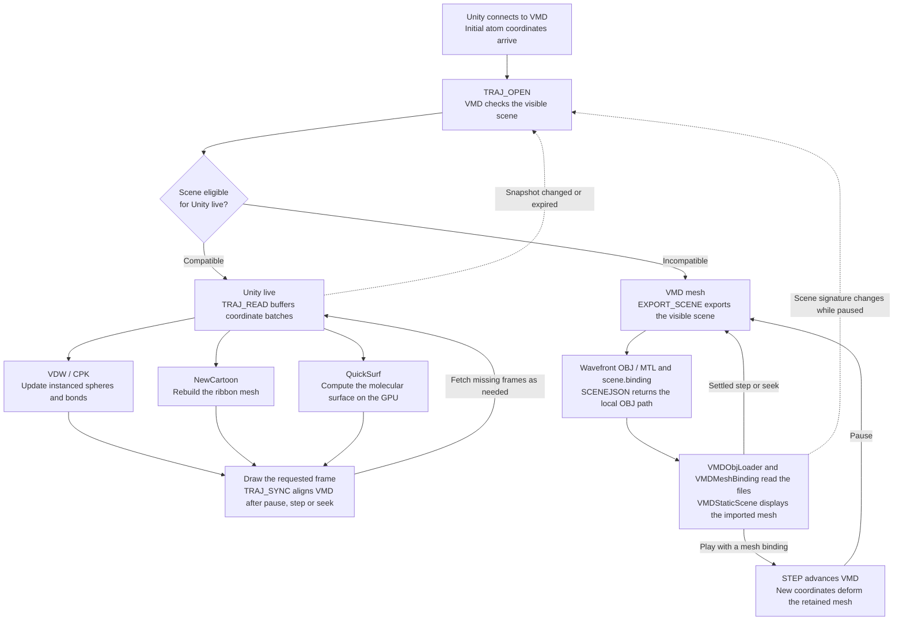

# VMD → Unity viewer: developer notes

How the viewer works, for people changing it. To use it, start with the [VR Quick Start](../README.md#vr-quick-start). Related documents:

- [COORDINATE_PLAYBACK.md](COORDINATE_PLAYBACK.md): the live renderers (VDW/CPK, NewCartoon, QuickSurf), a small-frame manual test and their Unity checks.
- [VR_ISSUES.md](VR_ISSUES.md): headset tests, launch procedures, hardware differences and open issues.

## Overview

VMD supplies molecular data, representation settings and coordinate snapshots through a local TCP bridge. Unity controls coordinate playback and its own camera; pause and seek synchronize the displayed frame back to VMD. Compatible scenes are drawn by Unity's own renderers (`[Unity live]`); other scenes use meshes exported by VMD (`[VMD mesh]`). See [Rendering](#rendering).

| Location | Contents |
| --- | --- |
| `start_vr.tcl` | Starts or reloads the bridge and prepares Lines/NewCartoon visibility on the top molecule. |
| `VMD_VR_Bridge/` | The Tcl TCP bridge (`vmd_vr_bridge.tcl` and the modules it sources) and its regression tests (`_test_*.tcl`). Test runs may leave `_test_bridge_result_*.txt` reports there, which git ignores. |
| `Unity_VR_Client/` | The Unity 6 client: scene, project settings, input configuration and C# scripts. Uses the Universal Render Pipeline. |
| `vr.cmd`, `tools/` | The [build, run, deploy](../README.md#build-run-deploy) command line and the lab bundle templates. |

## VMD bridge

`VMD_VR_Bridge/vmd_vr_bridge.tcl` opens a UTF-8, line-based TCP server on `127.0.0.1:45454`. It accepts local client connections, returns command results, and checks VMD state every 100 ms, broadcasting only when it changes. Because it is bound to the loopback interface and exports use shared local files, Unity and VMD run on the same computer.

### Starting and stopping

Load the molecule and trajectory first, then from the repository root in VMD's Tk Console:

```tcl
source start_vr.tcl
```

From another working directory, use the script's full path (replace the example path with your repository location):

```tcl
source {C:/path/to/VMD_Animation/start_vr.tcl}
```

The launcher locates the bridge relative to itself, so no personal paths need editing. It hides every **Lines** representation and shows every existing **NewCartoon** representation on the current top molecule, identifying them by drawing method rather than rep index. Other representations keep their visibility, no representations are created, and molecular data and drawing parameters are preserved. If there is no NewCartoon and hiding Lines leaves nothing visible, add or show a supported representation in **Graphics → Representations** before entering Unity Play mode. The visibility adjustment applies to the molecule loaded when the launcher runs.

Unity retries the connection every 2 seconds, so VMD and Unity can start in either order. Sourcing `start_vr.tcl` again reloads the bridge and disconnects its clients; Unity reconnects and reloads the trajectory from frame 0.

Manual start, without the visibility changes, from the repository root:

```tcl
source VMD_VR_Bridge/vmd_vr_bridge.tcl
::vrbridge::start
```

Before manually reloading an active bridge, run `::vrbridge::stop`; Unity reconnects once the bridge is started again. To stop it:

```tcl
::vrbridge::stop
```

**Rep visibility by hand.** `mol showrep top <rep> on|off` only shows or hides a representation (`top` is the top molecule, `<rep>` its rep index from 0 in **Graphics → Representations**, not a frame); it does not change the drawing method or delete anything. Check which index is NewCartoon first: if NewCartoon is rep 0, `mol showrep top 0 off` hides NewCartoon, not Lines. Changing a rep's drawing method keeps its visibility, so a hidden rep stays hidden after switching to NewCartoon. For example, with Lines as rep 0 and NewCartoon as rep 1:

```tcl
mol showrep top 0 off
mol showrep top 1 on
```

To test NewCartoon playback, keep the NewCartoon rep visible and hide reps such as Lines that would select the VMD mesh route. If the model stays blank, check the atom selection, the backbone data and the Unity Console.

### Port

45454 is the default on both sides. To use another port, set it in VMD before starting the bridge and give Unity the same value:

```tcl
set env(VMD_VR_PORT) 45455
source start_vr.tcl
```

Unity's `VMDClient` uses, in order: the `-vmdPort <port>` command-line argument of a built player, the `VMD_VR_PORT` environment variable, then the **Port** field in the Inspector. `::vrbridge::start <port>` also accepts an explicit port.

### Protocol handshake

After connecting, Unity sends `HELLO <version>`. The bridge replies `HELLO OK <version>` when it matches its `protocol_version`, otherwise `HELLO MISMATCH <bridgeVersion>`. Unity sends no other commands until the handshake succeeds. With no reply within 5 s it disconnects, shows the reason in the status bar and keeps retrying; on a mismatch, or on a bridge too old to know `HELLO`, it stops retrying until Play mode is restarted, since every retry would fail the same way. The bridge itself does not require `HELLO`, so console tests and older tools keep working. Increase `protocol_version` in the bridge and `VMDClient.ProtocolVersion` together, and only for changes that break existing clients.

When a client connects, the bridge sends `READY VMD_VR_BRIDGE <protocolVersion>` (currently 1) followed by the current `STATE` (or an error if no molecule is loaded). State messages include the top molecule ID, current frame, total frame count, and VMD rotation, center, scale and global matrices. Unity reads the frame and frame count from this message; it does not apply these matrices to its camera. Trajectory metadata and mesh bindings carry their own geometry transforms.

### Commands

| Command | Purpose |
| --- | --- |
| `PING` | Check whether the bridge is responding. |
| `HELLO <version>` | Check protocol compatibility; replies `HELLO OK <version>` or `HELLO MISMATCH <bridgeVersion>`. |
| `STATE` | Request the current molecule, frame count, frame index and VMD transformation matrices. |
| `PLAY` / `PAUSE` | Start or pause VMD-side playback; Unity uses its own trajectory controller instead. |
| `TOGGLE` | Legacy VMD-side command; Unity Play/Space uses its own playback controller. |
| `FRAME <index>` | Move to an exact trajectory frame. |
| `STEP <delta>` | Move forward or backward by a number of frames, clamped to the valid range. |
| `HIGHLIGHT <selection>` | Legacy: add a VDW representation in VMD for `N_DOMAIN`, `C_DOMAIN` or `LINKER`; `ALL` removes it. Unity no longer uses it. |
| `SELECT <requestId> <selection>` | Resolve a selection name or VMD selection text on the top molecule to atom indices, without changing VMD. Replies `SELJSON {"requestId":…,"atomCount":…,"label":…,"indices":[…]}`, or `SELJSON` with `"error"`. |
| `GET_COORDS` | Return the current top molecule's atom coordinates. |
| `GET_SCENE_STATE` | Return the scene signature used to detect representation, visibility and frame changes. |
| `EXPORT_SCENE <requestId>` | Export the visible VMD scene to OBJ/MTL and return its local path. |
| `SET_REPRESENTATION <requestId> <repIndex> <method>` | Change the top molecule's representation in VMD, then export the scene. Methods: VDW, CPK, QuickSurf, NewCartoon, and Original (the rep's style before the bridge first changed it). NewCartoon returns a rep without a protein backbone, or with nucleic acid, to its original style; QuickSurf keeps a rep's original QuickSurf parameters. |
| `RELEASE_SCENE <requestId>` | Release an export's import lease after Unity has read its files. |
| `TRAJ_OPEN <requestId>` | Check compatibility and return a coordinate snapshot's token, metadata and initial transform. |
| `TRAJ_READ <requestId> <token> <start> <count>` | Read a bounded batch of coordinates without changing VMD's displayed frame. |
| `TRAJ_CHECK <requestId> <token>` | Validate the snapshot and return VMD's current frame. |
| `TRAJ_SYNC <requestId> <token> <frame>` | Set VMD's frame to Unity's after pause or seek. |
| `TRAJ_STYLE <requestId> <repIndex> <method>` | Change the drawing method and invalidate the previous trajectory snapshot. |
| `HELP` | Return the supported command names. |

### Named selections

The `selections` array in `vmd_vr_bridge.tcl` maps names to VMD selection text for `SELECT` and `HIGHLIGHT`; `::vrbridge::define_selection` adds or replaces entries (see [Changing what is highlighted](../README.md#changing-what-is-highlighted)). The built-in `N_DOMAIN`, `C_DOMAIN` and `LINKER` hard-code the residue ranges of the MutLα sample. They do not identify domains in other proteins or numbering schemes. VMD's `resid` is the residue identifier, not the atom index, and the expressions do not restrict `chain` or `segname`, so repeated residue IDs across chains can include unintended atoms. `ALL` is reserved; `HIGHLIGHT ALL` removes the added representation and does no domain detection.

## Unity client

Scripts under `Unity_VR_Client/Assets/Scripts/`:

| Script | Responsibility |
| --- | --- |
| `VMD/VMDClient.cs` | TCP connection, commands, coordinate/state parsing, static-scene forwarding and cancellable trajectory requests matched by request ID. |
| `VMD/VMDKeyboardController.cs` | Desktop frame and trajectory-playback key bindings. |
| `VMD/VMDVRController.cs` | XR controller face buttons and thumbsticks: play/pause, frame steps, drawing method, recenter. |
| `XR/VMDXRBootstrap.cs` | Chooses Desktop, Simulator or Headset mode at startup, enables the matching camera rig, and fits the molecule in front of the user. |
| `XR/VMDMoleculeGrab.cs` | Grabbing: one hand moves and rotates the molecule, two hands also scale it. |
| `XR/VMDIndexGrip.cs` | Switches grabbing to the trigger on Valve Index controllers. |
| `XR/VMDStatusPanel.cs` | World-space playback controls and status, with controller-ray input. |
| `Highlight/VMDHighlightController.cs` | Highlights a VMD selection by muting every other atom's color in the live renderers, without changing VMD. |
| `XR/VMDRayHighlight.cs` | In XR modes, highlights the selection that the right controller's ray points at. |
| `Molecule/MoleculeRenderer.cs` | Original atom objects, coordinate updates, automatic centering and atom scale; initializes the representation controller. |
| `Molecule/RepresentationController.cs` | Static export requests, representation-switch commands, loading and switching between static and coordinate views. |
| `Representations/VMDObjLoader.cs` | Generic OBJ/MTL parsing, coordinate-handedness conversion and mesh chunking. |
| `Representations/VMDStaticScene.cs` | Upload imported geometry to Unity meshes and release resources. |
| `Representations/VMDMeshBinding.cs` | Bind exported mesh vertices to selected atoms for approximate coordinate-driven deformation. |
| `Trajectory/TrajectoryController.cs` | Shared Play/Pause/Step/Seek/Speed API and status bar; automatic bounded coordinate prefetch for VDW/CPK, protein NewCartoon and QuickSurf, with existing playback kept for other representations. |
| `Trajectory/VMDCoordinateScene.cs` | Reusable instanced atom spheres and CPK bond cylinders driven by coordinates. |
| `Trajectory/VMDCartoonScene.cs` | NewCartoon spline and ribbon mesh rebuilt from each frame's backbone. |
| `Trajectory/VMDQuickSurfScene.cs` | QuickSurf rebuilt on the GPU from each frame's atoms (`VMDQuickSurfGrid.compute`, `VMDQuickSurf.shader`). |
| `Camera/VMDCameraController.cs` | Orbit, pan, zoom and complete-molecule framing. |

`Assets/Resources/VMDStaticGeometry.shader` displays imported colors and material properties. VDW/CPK use reusable Unity spheres and bonds; protein NewCartoon reconstructs its spline and ribbon mesh from each coordinate frame; QuickSurf rebuilds its Gaussian density surface on the GPU from each frame. These paths share automatic coordinate prefetch and the playback controls. Unsupported scenes, and QuickSurf on a device without compute shaders, keep VMD-generated geometry. Details: [COORDINATE_PLAYBACK.md](COORDINATE_PLAYBACK.md).

**Playback.** Keyboard, Game-view buttons, XR controllers and the XR status panel all call `TrajectoryController`. At speed 1x it shows one frame every `stepInterval` (0.1 s); Speed divides that interval.

**Drawing-method switching.** For new keyboard, UI or XR bindings, call `SetVDW()`, `SetCPK()`, `SetQuickSurf()`, `SetNewCartoon()`, `NextRepresentation()` or `PreviousRepresentation()`. `SetRepresentation(int repIndex, string method)` targets one representation on VMD's top molecule. Style changes pause playback, keep the displayed frame for the same molecule, and run the compatibility check again. Switching applies that method's default parameters while keeping selection, coloring, material and visibility; QuickSurf keeps a rep's original QuickSurf parameters, and NewCartoon returns reps it cannot draw (lipids, ions, water, nucleic acid) to their original style. In XR, Right B calls `NextRepresentation()`; its cycle starts at Original (the scene's own look, with the script's own parameters) and leaves out a method every rep already used at the start. Presses during a change are ignored (status: Switching drawing method).

## XR

### XR modes

`VMDXRBootstrap` chooses one mode when Play mode or a player starts:

| Mode | When | Camera |
| --- | --- | --- |
| Simulator | In the Editor while **Simulate In Editor** is checked on the `VMDXRBootstrap` component (the default). | XR Origin driven by the XR Interaction Simulator. |
| Headset | Otherwise, when an OpenXR runtime and headset start. Uncheck **Simulate In Editor** to use a headset from the Editor. | XR Origin tracked by the headset. |
| Desktop | No OpenXR runtime or headset, or a built player started with `-desktop`. | The desktop camera and desktop controls. |

**Startup.** XR Plug-in Management does not initialize XR on startup, so a missing runtime never blocks Play mode. The bootstrap chooses Headset mode in `Awake` but starts XR a few frames later, after the player has applied its startup window resolution; starting XR earlier made that switch fail ("Couldn't switch to requested monitor resolution") or hang on a PC with both integrated and NVIDIA graphics. If XR does not start, the scene reloads in Desktop mode; the log shows the chosen mode and `XR started.` on success.

**Tracking origin.** Once XR runs, the bootstrap makes the XR Origin apply the runtime's tracking origin mode. `XROrigin` sets it up in its own `Start`, before XR exists, and would otherwise keep its 1.36 m Device-mode camera height on top of the runtime's floor-relative head pose (seen in Meta XR Simulator as eyes at about 3 m; [VR_ISSUES.md](VR_ISSUES.md) issue 7).

**Placement.** In Simulator and Headset modes the molecule is scaled to a 0.8 m radius and placed 0.15 m below eye level and 1.5 m in front of the user, along the direction the head faces (SteamVR's play-area forward need not match it); size and offset are fields on the component. This happens once, when the molecule first appears, and the status panel is placed with it; drawing-method switches and reconnects keep the user's grabs and scaling, and Recenter fits it again. In Headset mode the first fit waits until the headset is in use (the OpenXR session is focused and the runtime reports a user present), then until the head pose has been steady for 1 s (moved less than 5 cm and turned less than 10°; at most 10 s), so a headset lying on a desk, being picked up or being put on does not fix the view; it also turns the molecule's front toward the user. When the runtime moves its tracking origin (a system recenter, a new play area), the molecule and the panel are placed again. Immersive size is a 4 m radius centered at head height and slightly ahead (`immersiveRadius`, `immersiveCenterAhead`); the molecule shaders draw both faces, so inside a closed surface such as QuickSurf the user sees its inner side.

**Diagnostics.** Each fit logs the measured bounds and scale, and a `[VMDView]` line with the head pose (local and world), the XR Origin pose and the target. After XR starts, a `[VMDView]` line also records the XR Origin's requested and current tracking origin mode, its camera height offset, and what the OpenXR input subsystem reports. Compare these lines between Meta XR Simulator (`vr run`) and a headset's `Player.log` when the view is off.

**Background.** In Simulator and Headset modes the head camera clears to a plain dark gray (`xrBackground` on `VMDXRBootstrap`) instead of the default skybox, whose horizon and ground do not match the real floor. The desktop camera keeps the skybox.

**Headset connection.** The bridge listens only on `127.0.0.1` and exports meshes through local files, so the headset must run as a PC VR display of the computer running VMD (Quest Link, Air Link or SteamVR). A standalone headset app cannot reach the bridge. The code does not branch on the headset model; the differences between the tested headsets are in [VR_ISSUES.md](VR_ISSUES.md#what-differs-from-the-index).

### Input

`VMDVRController` maps the face buttons and thumbsticks through OpenXR usages, so Quest Touch, Index, Vive and the XR Interaction Simulator share one mapping. Two-handed grabbing scales between 0.05× and 50× per grab instead of XRI's default 0.25×–2×. The molecule's grab target is a box collider around its drawn geometry (`VMDMoleculeGrab`).

**Valve Index.** The Index grip reports finger curl, so simply holding the controller would keep the molecule grabbed. `VMDIndexGrip` therefore switches grabbing to the trigger when an Index controller is present: hold the trigger to grab, let go to release; both triggers on the molecule scale it. The switch also releases any grab made with the grip binding before it (a controller turned on while held could grab at once and never let go). The trigger still presses panel buttons; the ray decides whether it points at the panel or the molecule. Other controllers keep the grip button. The panel's usage text follows the controller type.

**Status panel.** `VMDStatusPanel` places a 38 × 17 cm panel ahead and to the left of where the user was looking, upright and facing the head; it copies the desktop panel's layout and adds the **Pointing** button, its status line and the controller bindings. At immersive size the hand is always inside the molecule's grab volume, so XRI's Near-Far interactor would cast only near and lose UI presses; `KeepRaysOnPanel` turns near casting off for a hand whose ray aims at the panel and that holds nothing. In XR modes the scene's EventSystem uses `XRUIInputModule` instead of `InputSystemUIInputModule`; desktop mode is unchanged.

**XR Interaction Simulator.** The simulator hands a key still held when Shift is released to the right controller, which would make Shift + 1 also toggle Play/Pause and Shift + 2 also switch the drawing method; in Simulator mode `VMDVRController` therefore ignores the right controller's buttons and thumbstick for 0.2 s (at least three frames) after Shift is released. Grip and trigger go through the XR Interaction Toolkit and are not covered, hence "release G or T before Shift".

### Stereo rendering

The OpenXR runtime supplies each eye's view and projection, distortion correction and frame timing. In OpenXR render mode **Single Pass Instanced**, Unity renders both eyes into one texture array, so every custom shader must carry Unity's stereo-instancing macros (`UNITY_VERTEX_INPUT_INSTANCE_ID`, `UNITY_VERTEX_OUTPUT_STEREO`, `UNITY_SETUP_INSTANCE_ID`, `UNITY_INITIALIZE_VERTEX_OUTPUT_STEREO`, and `UNITY_SETUP_STEREO_EYE_INDEX_POST_VERTEX` in the fragment shader, which also selects the per-eye `_WorldSpaceCameraPos`); without them the geometry appears in only one eye. The four shaders under `Assets/Resources/` carry them. **Multi-pass** (Project Settings → XR Plug-in Management → OpenXR) renders each eye separately at roughly twice the GPU cost; the lab launchers use a Multi-pass build because SPI showed one eye only on a Valve Index ([VR_ISSUES.md](VR_ISSUES.md) issue 9).

## Highlighting

`VMDHighlightController` sends `SELECT <requestId> <selection>`; the bridge resolves the selection on the top molecule to atom indices, and Unity mutes the color of every other atom in the live VDW, CPK, NewCartoon and QuickSurf renderers. VMD's representations and the trajectory snapshot are untouched, so nothing reloads: playback, frame synchronization and the XR placement are unaffected.

- The component is added to the `VMDClient` object at runtime when the scene has none (by `VMDKeyboardController`, or by `VMDStatusPanel` in XR modes). Its **Selections** list holds bridge names or VMD selection text; **Dimming** sets how strongly other atoms are muted.
- The desktop H key sends one `SELECT` per press. The highlight follows representation changes made in VMD and is cleared when the connection drops, since VMD may serve another molecule afterwards.
- The legacy `HIGHLIGHT` bridge command, which adds a VDW representation in VMD, is unchanged; Unity no longer uses it.

**Ray highlighting (`VMDRayHighlight`).** All entries of the list are resolved with one `SELECT` each when VMD connects, so switching between parts sends nothing to VMD. Atoms in no entry are ignored, and when entries overlap an atom belongs to the first. The ray picks what is drawn:

- QuickSurf: the point where the ray enters a surface, found by evaluating the same Gaussian density along the ray, and the atom contributing most density there.
- VDW and CPK: the first drawn sphere the ray enters.
- NewCartoon: the first atom within 4 Å of the ray (**Pick Radius** on the component).

The nearest hit wins. A surface or sphere that contains the hand is passed through, so at immersive size the ray picks what it points at; only what the ray enters is picked, never just the structure around the hand. Nothing is picked while the ray rests on the status panel, and the highlight clears about 0.25 s after the ray leaves the molecule. The Near-Far interactor hides its ray while the hand is inside the molecule's grab volume, which at immersive size is all the time; the controller's aim is still used, and a thin white pointer line from the hand to the hit (or 3 m ahead) shows it. In Simulator mode the pick follows the mouse cursor (the camera's ray through it) instead of the controller's ray: the simulator aims the controller at the point where the cursor's physics ray hits the molecule's grab volume, so the controller's own ray passes beside the atom under the cursor. Each change of the pointed part is logged as a `[VMDHighlight]` line. Checked on a Valve Index (2026-11-18, [VR_ISSUES.md](VR_ISSUES.md) issue 10), not yet on a Meta Quest.

## Rendering



**Unity live compatibility.** One visible top molecule with atoms and frames, and all visible representations must use VDW, CPK, protein NewCartoon or QuickSurf with a supported coloring method, fixed selection and opaque material. Periodic images, smoothing, dynamic selection or color updates, or any unsupported visible representation (such as Lines) select VMD mesh for the whole scene. QuickSurf also requires compute shaders and asynchronous GPU readback. Supported colorings and renderer details: [COORDINATE_PLAYBACK.md](COORDINATE_PLAYBACK.md#implementation-and-scope).

**Manual export and import.** Pause playback and use **Export current VMD scene** or call `RefreshFromVMD()`. To import a saved export, set `Local Obj Path` and use **Load local VMD OBJ**, keeping the referenced MTL file alongside the OBJ. Keep `scene.binding` alongside bridge exports if coordinate-driven mesh playback is needed; older OBJ/MTL pairs remain loadable as static geometry. **Return to coordinate view** restores the original atom view. Explicit export/import and atom-view actions leave automatic coordinate rendering until a style change.

### Current behavior and limitations

- Mesh deformation is approximate. VDW vertices follow their nearest selected atom. Other methods blend four neighboring atom displacements. Topology stays fixed and other molecules remain static. The previous mesh stays visible while a refresh export is imported.
- Export includes the entire visible VMD scene, not just the top molecule. Unity recenters imported geometry and fits the camera; it does not apply VMD view matrices again.
- Files are shared locally under `%LOCALAPPDATA%/VMD_VR/exports/` (`~/.vmd_vr/exports/` when `LOCALAPPDATA` is not defined), independent of the repository layout; Unity imports the absolute path returned by VMD. Each request gets a separate directory containing OBJ, MTL and binding data. An import lease protects files while Unity reads them; exports have a two-second cooldown, and completed bridge-owned exports are pruned to a bounded set. Copy OBJ, MTL and binding together elsewhere to keep a playable export.
- Static export raises visible QuickSurf representations to a minimum grid spacing of 2.0 to limit export memory. This setting persists in VMD; it is not restored after export.
- Lighting and transparency may differ from VMD. Texture maps and OBJ points/lines are not displayed. Limits: 128 MB per OBJ, 16 MB per MTL, 2 million input vertices and 500,000 output triangles.
- The Unity NewCartoon coordinate renderer supports CA-only amino-acid models as smooth coils without STRIDE. VMD Wavefront export may still produce empty NewCartoon geometry for CA-only data; use the live route or a complete-backbone structure where appropriate.
- Once the coordinate buffer is full, `TRAJ_CHECK` validates the snapshot at 0.75-second intervals. The paused mesh route polls the scene signature every 0.5 seconds and coalesces refresh requests. Camera-only changes do not trigger an export. In-place coordinate, radius or bond edits not reflected in scene settings require restarting Play mode.
- The coordinate buffer defaults to 24 frames and targets 64 MiB of positions, with a minimum of two frames (one for a single-frame molecule). This excludes metadata, rendering buffers and parsing allocations. Requests contain at most four frames, reduced for large molecules. QuickSurf uses a bounded GPU grid and may coarsen its spacing; its surface can lag the displayed coordinate frame.
- On the VMD mesh route the playback speed is an upper limit, since each step also waits for VMD's export.
- Headset mode has been tested on a Valve Index and on a Meta Quest over USB Link; Quest Air Link and Steam Link are untested, and some changes made after the Index tests are still unverified (see [VR_ISSUES.md](VR_ISSUES.md)). Standalone (untethered) headset apps, atom picking beyond the part under the ray, and cross-computer mesh transfer are outside this phase.

## Validation

Run the bridge tests in separate VMD text processes from `VMD_VR_Bridge/`, not by sourcing them in an active research session. `vr test` runs all four and summarizes them. By hand, in PowerShell with VMD installed at the default Windows path:

```powershell
cd VMD_VR_Bridge
& 'C:\Program Files\VMD\vmd.exe' -dispdev text -e ./_test_bridge.tcl -eofexit
& 'C:\Program Files\VMD\vmd.exe' -dispdev text -e ./_test_static_export.tcl -eofexit
# Choose a writable location for the coordinate fixtures used by Unity checks.
$env:VMD_COORDINATE_TEST_ROOT = Join-Path $env:TEMP 'VMDCoordinateTests'
& 'C:\Program Files\VMD\vmd.exe' -dispdev text -e ./_test_trajectory.tcl -eofexit
& 'C:\Program Files\VMD\vmd.exe' -dispdev text -e ./_test_cartoon.tcl -eofexit
```

| Test | Covers |
| --- | --- |
| `_test_bridge.tcl` | Command validation, the `HELLO` handshake, port configuration, `SELECT` and named selections, frame control and clamping, the legacy `HIGHLIGHT`, TCP connection handling and state broadcasts. |
| `_test_static_export.tcl` | The four drawing methods, complete-backbone NewCartoon, invalid requests, preservation of scene settings, coordinates and frame stepping. Fixtures, manifests and results go to `Unity_VR_Client/Temp/static-export-tests/`. |
| `_test_trajectory.tcl`, `_test_cartoon.tcl` | Coordinate snapshots and NewCartoon fixtures; see [COORDINATE_PLAYBACK.md](COORDINATE_PLAYBACK.md#verification). |

Unity checks under `Unity_VR_Client/Tests/` cover coordinate playback, NewCartoon reconstruction, QuickSurf GPU rendering and fallback, and the handshake, in isolated Editor projects; see [COORDINATE_PLAYBACK.md](COORDINATE_PLAYBACK.md#verification) for fixture and graphics requirements. These checks do not establish production frame rates or headset readiness. Rerun the applicable tests against the current working tree; historical results are not a current guarantee. Game-view comparison on the intended dataset and headset validation remain necessary.

## Generated files and version control

`.gitignore` excludes Unity caches and builds, IDE output, bridge test results and local environment files. Static-export test fixtures go under `Unity_VR_Client/Temp/`, and runtime mesh exports use the per-user directory described under [Current behavior and limitations](#current-behavior-and-limitations). Keep private molecular data and local exports under the ignored `local/` directory at the repository root. The bundled sample assets, source scripts, shaders, Unity `.meta` files and project settings are tracked.
